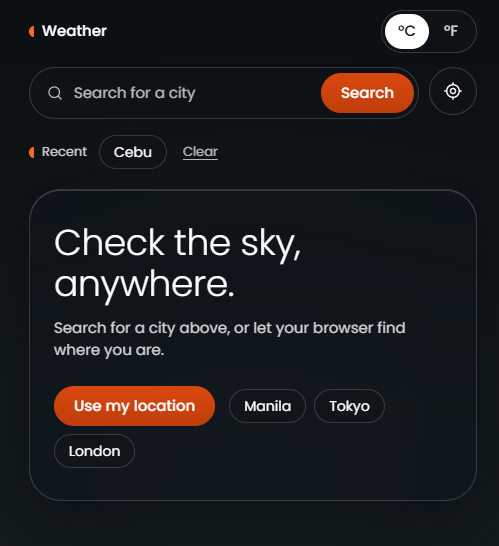
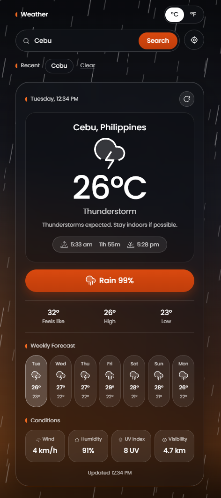

# Weather App

A responsive weather application built with HTML, Tailwind CSS, and JavaScript. Search for a city, explore current weather conditions, and check the five-day forecast in one place.

<p align="center">
  <a href="https://vinn-devv.github.io/Weather-App/">
    
  </a>
</p>

<p align="center">
  
  
  
  
</p>

---

## Overview

Check the weather wherever you need it. This application retrieves weather information through the Open-Meteo API and displays it in a clean, easy-to-use interface.

## Features

| Feature                | Description                                                        |
| ---------------------- | ------------------------------------------------------------------ |
| City Search            | Search for weather conditions by city name                         |
| Current Weather        | View temperature, feels-like temperature, humidity, and wind speed |
| Temperature Conversion | Switch between Celsius and Fahrenheit                              |
| Five-Day Forecast      | Explore upcoming weather conditions and temperatures               |
| Weather Advice         | Get practical suggestions based on current conditions              |
| Current Location       | Use browser geolocation to check local weather                     |
| Recent Searches        | Revisit previous searches or clear search history                  |
| Local Time             | View the local time of the selected city                           |
| Refresh Weather        | Retrieve updated weather information                               |
| Responsive Layout      | Use the application across different screen sizes                  |

## Preview

**Live Demo:** [Open Weather App](https://vinn-devv.github.io/Weather-App/)

### Weather App



### Current Weather



## Technologies Used

- **HTML5** — markup language used to structure the application
- **Tailwind CSS** — utility-first CSS framework used for styling and responsive layouts
- **JavaScript** — programming language used for application logic and interactivity
- **Open-Meteo API** — provides geocoding and weather forecast data
- **Browser Geolocation API** — retrieves the user's current coordinates with permission
- **Local Storage** — saves recent search history in the browser
- **SVG** — used for weather icons

## Getting Started

### Run Locally

1. Clone the repository:

   ```bash
   git clone https://github.com/vinn-devv/Weather-App.git
   ```

2. Open the project folder:

   ```bash
   cd Weather-App
   ```

3. Open `index.html` in your browser or use the Live Server extension in VS Code.

No API key is required for the Open-Meteo endpoints used by this project.

## Project Structure

```text
Weather-App/
├── index.html
├── app.js
├── styles.css
└── README.md
```

_Adjust this structure if your repository uses different filenames or does not contain `styles.css`._

## What I Learned

- Fetching data from external APIs
- Using `async` and `await` with error handling
- Manipulating the DOM with JavaScript
- Working with browser geolocation
- Saving data with Local Storage
- Creating responsive layouts with Tailwind CSS
- Displaying weather information dynamically

## Author

**Renzo Cabaya**

[GitHub Profile](https://github.com/vinn-devv)

---

<p align="center">
  Built with HTML, Tailwind CSS, and JavaScript.
</p>
